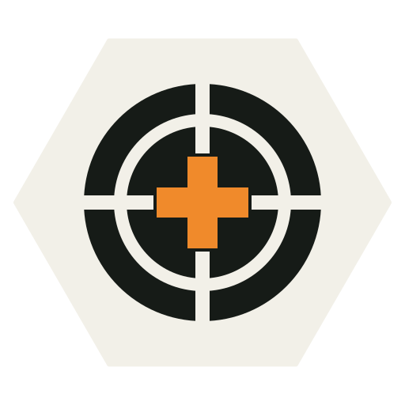

# Antistasi Ultimate QoL Extension (AUQOL)

An Arma 3 mod that adds quality-of-life features and smarter AI to Antistasi Ultimate, without editing the mission.

## What it does

- **For you and your squad:** no weapon sway, unlimited stamina, no weight limit, a recoil slider, faster pistol swap, and a 1-second Withstand cooldown. Your squad AI get your perks.
- **Logistics:** service trucks never run dry, any vehicle can gather scattered loot (and empties nearby enemy supply crates), light scratches no longer ask for Repair, map markers follow their vehicles live, and "Copy from user" in the rebel loadout editor.
- **AI:** friendly AI react and move faster, no AI going prone, looking at enemies or pressing T alerts your squad (with radio call-outs and breach and clear), your squad holds fire in Stealth until you shoot and covers you when you stop, launchers come out at once against vehicles, wounded AI treat themselves, stuck AI get freed, and AI squads fight from cover as fire teams.
- **Stealth:** enemies without night vision see less at night, you can hide in the grass (like the HATG mod), and far shots don't give away where you are.
- **Enemy vehicles:** crews leave vehicles that can no longer move. Parked vehicles and wrecks far from players are frozen to save server work.

Every feature has its own setting in Addon Options and can be switched while playing. Nearly all are on by default; [docs/configuration.md](docs/configuration.md) lists the few that are not.

## How it works

AUQOL is a CBA addon. It hooks into Arma and Antistasi through events and their public functions at runtime, so it needs no mission changes and works next to ACE3, RHS, CUP, HATG and other mods. Settings are forced by the server; work runs on the machine that owns each unit (server, headless client or player).

## Install

Needs [CBA_A3](https://github.com/CBATeam/CBA_A3) and Arma 3 2.14+. Download `@auqol` from [Releases](https://github.com/thomkr01/antistasi-ultimate-qol-extension/releases) and load it on the server and every client, for example `-mod=@CBA_A3;@AntistasiUltimate;@auqol`.

## More

- [FEATURES.md](FEATURES.md): each feature in detail, how it works and known limitations
- [docs/configuration.md](docs/configuration.md): every setting
- [docs/compatibility.md](docs/compatibility.md): Antistasi, ACE3, RHS, CUP and other mods
- [docs/installation.md](docs/installation.md): install, building from source, troubleshooting
- [docs/testing.md](docs/testing.md): checks and in-game test plan
- [CHANGELOG.md](CHANGELOG.md), [FILEMAP.md](FILEMAP.md)

## License

MIT, see [LICENSE](LICENSE). This project contains no code from Antistasi Ultimate, CBA_A3, ACE3 or Hide Among The Grass. It only calls their public functions at runtime.

The three concealment indicator icons in `addons/main/data/conceal/` are from [Hide Among The Grass](https://github.com/Antistasi-Ultimate-Community/HATG) by SilenceIsFatto and MaxxLite, used unchanged under the [Arma Public License Share Alike (APL-SA)](https://www.bohemia.net/community/licenses/arma-public-license-share-alike); those files stay under that licence.
